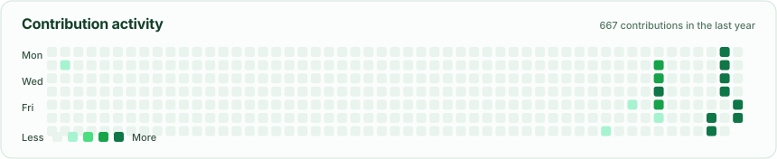
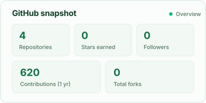
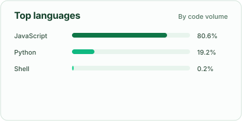

<div align="center">


<br/>

# Hui Jiang · 姜慧

**Adaptive Test-Time Reasoning · LLM Evaluation · Agent & Reasoning Systems**

Master's student at **UCAS / CASIA** · Former industry data analyst with 3+ years of experience

<a href="mailto:jianghui2024@ia.ac.cn">
  
</a>
<a href="https://github.com/JiangHui0203">
  
</a>

<br/><br/>

<code>Python</code> · <code>PyTorch</code> · <code>Transformers</code> · <code>SQL</code> · <code>LLM Evaluation</code> · <code>Experiment Design</code>

</div>

---

## About · 关于我

我目前在 **中国科学院大学人工智能学院 / 中国科学院自动化研究所** 攻读硕士学位，研究重点是 **Adaptive Test-Time Reasoning**：如何判断模型什么时候需要更多推理、额外计算应该分配到哪里，以及如何在局部推理状态出现风险时进行选择性干预。

在读研之前，我曾在 **厦门市美亚柏科信息股份有限公司北京分公司**担任数据分析师三年多，长期处理百万至亿级多源异构数据，并参与关系发现、身份融合、规则策略、验证评估与业务交付。

> **Research thesis**  
> **When should a model think more, where should additional test-time compute be spent, and when should we intervene?**

### Current focus

- **Adaptive Reasoning** — 按任务与状态动态决定推理深度，而不是统一增加思考预算。
- **Test-Time Compute Allocation** — 研究额外推理计算在何时真正产生价值，以及如何进行预算分配。
- **Reasoning State Evaluation** — 评估中间推理状态的局部价值、风险与可修复性。
- **Selective Intervention** — 只在高风险或高价值位置触发候选生成、验证与局部修复。
- **Mechanistic Analysis** — 从内部表示与功能单元角度理解逻辑推理能力的组织方式。

---

## Research trajectory · 研究主线

```text
Understand reasoning
        ↓
Evaluate reasoning states
        ↓
Allocate test-time compute
        ↓
Intervene selectively
```

我希望把不同工作收束到同一个问题：**如何让推理模型把有限计算花在真正值得思考的位置。**

---

## Selected research · 代表研究

<table width="100%">
  <tr>
    <td width="50%" valign="top">
      <h3>More Thinking Is Not Always Better</h3>
      <p><strong>First Author · NLPCC 2026</strong></p>
      <p>研究测试时推理深度与计算分配。实验表明，更多推理并不必然带来更高准确率；真正的问题是识别哪些实例值得额外计算，并避免无效甚至有害的过度思考。</p>
      <p>
        <a href="https://openreview.net/pdf?id=RigeZLi611">Paper</a>
        · <strong>Test-Time Reasoning</strong>
        · <strong>Adaptive Computation</strong>
      </p>
    </td>
    <td width="50%" valign="top">
      <h3>大语言模型中的逻辑神经元</h3>
      <p><strong>第一作者 · 《软件学报》</strong></p>
      <p>通过 gradient-based localization 与 inference-time intervention 分析逻辑推理相关功能单元，研究不同逻辑能力之间的共享与任务特异组织，并验证局部干预对推理表现的影响。</p>
      <p>
        <a href="https://www.jos.org.cn/josen/article/pdf/7704">Paper</a>
        · <a href="https://doi.org/10.13328/j.cnki.jos.007704">DOI</a>
        · <strong>Mechanistic Interpretability</strong>
      </p>
    </td>
  </tr>
</table>

### RoTFuse · Research in Progress

当前工作进一步把问题推进到**推理过程内部**：从当前真实前缀出发，在低置信推理单元附近触发有限探索，生成同前缀候选并进行选择，研究局部状态是否存在可预测、可利用的修复价值。

重点关注：

- low-confidence triggering;
- same-prefix candidate generation;
- local value / candidate selection;
- selective intervention under explicit compute budgets;
- end-to-end correctness vs. additional inference cost.

这条工作同时保留负结果和失败分析：候选差异不足、局部优势事件稀疏、selector signal 弱，以及“格式/终止修复”和真正语义修复之间的区别，都是当前研究的重要组成部分。

---

## Industry experience · 产业经历

### 厦门市美亚柏科信息股份有限公司（北京分公司）
**Data Analyst · 2021.04 — 2024.08**

- 使用 **SQL** 处理百万至亿级多源异构数据，完成数据清洗、治理、分析与验证。
- 参与复杂关系发现、跨域身份数据融合与规则策略设计。
- 覆盖从需求拆解、数据建模、实验验证到最终交付的完整工作流。
- 这段经历也塑造了我现在的研究习惯：**先定义可验证问题，再构建数据与评测，最后讨论方法收益。**

---

## Systems & builds · 系统与实践

### [VeriAgent](https://github.com/JiangHui0203/veriagent)
**Verifiable Agent Runtime**

探索可验证、可恢复、可审计的 Agent runtime，将 generation、verification、control 与 observability 解耦，并关注多步执行中的状态恢复、验证与错误归因。

### [NiceRice · 有时好饭](https://github.com/JiangHui0203/NiceRice)
**WeChat Mini Program · Side Project**

一个从真实生活需求出发的轻量项目：在日程、距离、天气、偏好与朋友时间之间寻找更合适的用餐安排。作为研究之外的工程实践保留在这里。

---

## Toolbox · 技术与方法

**LLM / Research**  
`PyTorch` · `Transformers` · `LLM Evaluation` · `Reasoning Analysis` · `Trajectory Analysis` · `Experiment Design` · `Statistical Testing`

**Engineering / Data**  
`Python` · `SQL` · `Linux` · `Bash` · `Git` · `OpenPAI` · `Data Processing`

**What I care about**  
rigorous baselines · paired comparisons · compute accounting · reproducible evaluation · failure analysis

---

## Education · 教育背景

- **中国科学院大学 · 人工智能学院 / 中国科学院自动化研究所** — *2024 — 2027*  
  硕士研究生 · LLM reasoning / evaluation / test-time computation

- **郑州轻工业大学 · 数学与应用数学** — *2017 — 2021*  
  理学学士 · 本科毕业论文获河南省优秀学士学位论文

---

## English snapshot

I am a Master's student at the **School of Artificial Intelligence, University of Chinese Academy of Sciences (UCAS)** / **Institute of Automation, Chinese Academy of Sciences (CASIA)**. My research centers on **adaptive test-time reasoning**: evaluating intermediate reasoning states, allocating inference-time compute, and selectively intervening when additional computation is likely to help.

Before graduate school, I worked for more than three years as an industry data analyst on large-scale heterogeneous data. This background strongly influences how I approach LLM research: define measurable failure modes, build controlled evaluations, account for compute, and analyze where a method genuinely adds value.

**Research interests:** LLM reasoning · test-time compute · reasoning evaluation · selective intervention · agent evaluation.

---

## GitHub activity

<div align="center">

<a href="https://github.com/JiangHui0203">
  
</a>

<br/><br/>

<a href="https://github.com/JiangHui0203">
  
</a>
<a href="https://github.com/JiangHui0203?tab=repositories">
  
</a>

</div>

---

<div align="center">

### when to think · where to think · when to stop

<sub>Reason carefully · Evaluate rigorously · Build things that work</sub>

</div>
